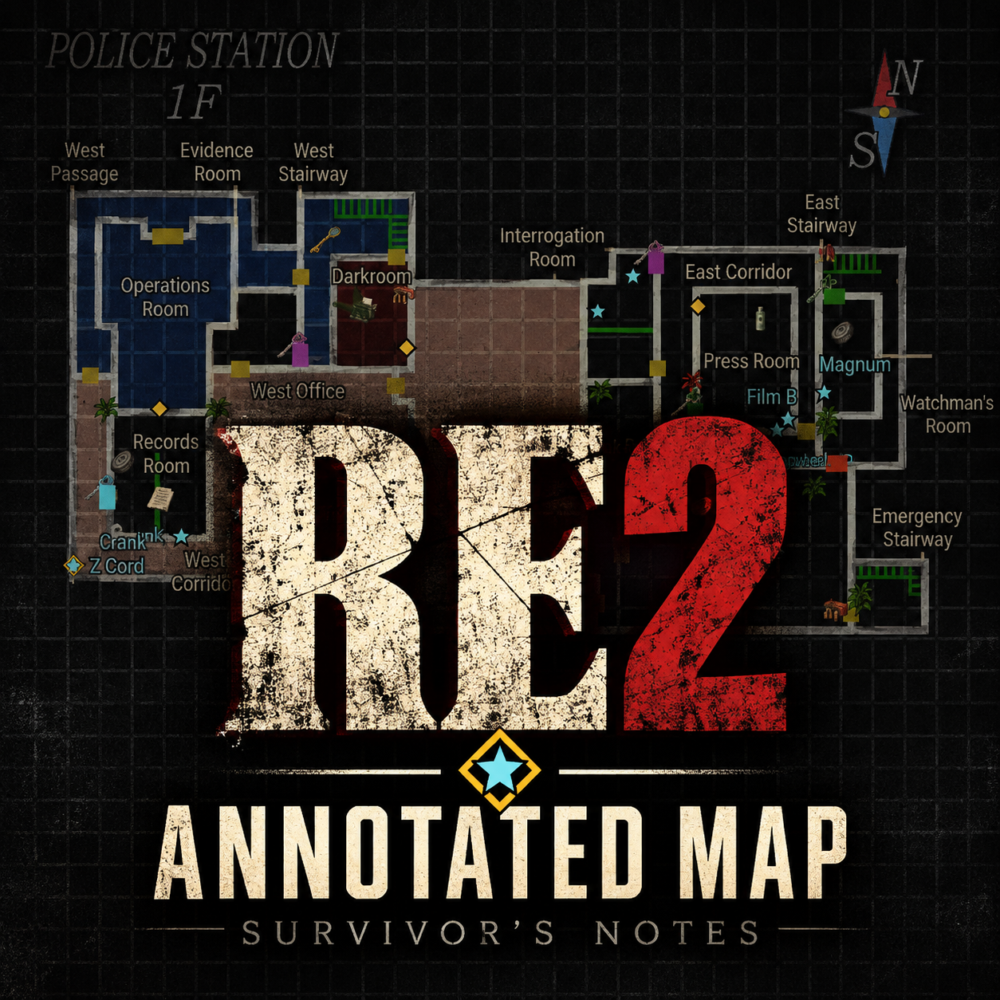
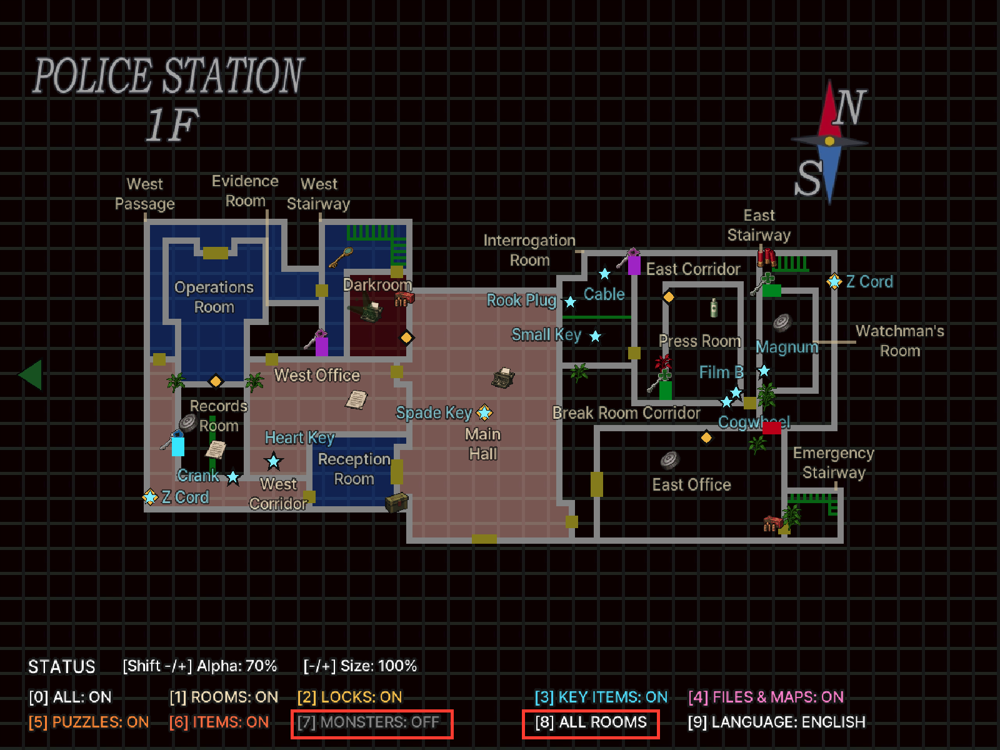
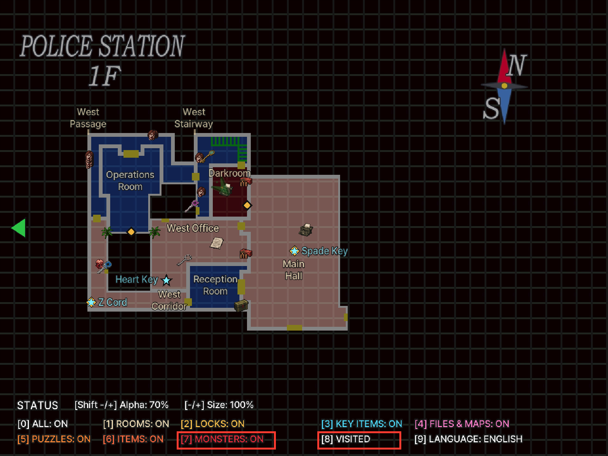
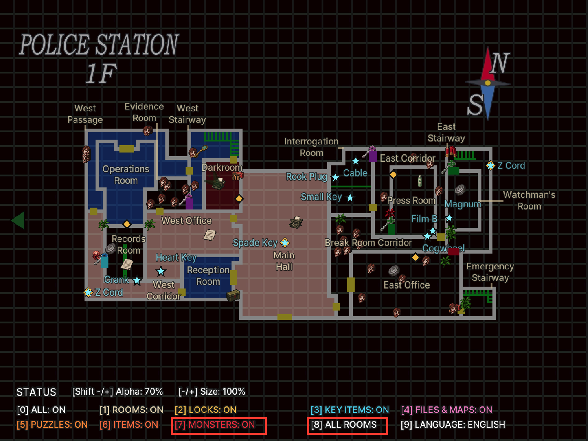

# RE2 Annotated Map - Survivor's Notes — Resident Evil 2 (1998)

English | [한국어](README.md)

<p align="center"></p>

An ASI mod for the original Resident Evil 2 PC release (GOG `Resident Evil 2.exe` + [Classic REbirth](https://classicrebirth.com/)) that adds room names, locked doors and their keys, key items, documents and maps, puzzles, common items, typewriters and item boxes, and monsters to the map. Korean and English are supported. This is not for the 2019 remake.

- Annotations are drawn on the game's own map screen. Picked-up items, opened doors, solved puzzles and killed monsters disappear from the map. Rooms with items left are tinted orange.
- Item and lock differences between Leon/Claire and scenarios A/B are reflected. Zapping items are shown too.
- On the status-screen map, left/right selects an area and up/down selects a floor. Only visited floors are shown.
- An optional live rank estimate uses the original results-screen formula (off by default).

## Screenshots

Red outlines highlight the monster toggle and room visibility scope being compared.

| | Visited rooms | All rooms |
|---|---|---|
| Monsters off |  |  |
| Monsters on |  |  |

## Visibility and defaults

A new configuration starts in **English, name size 100%, opacity 70%, visited rooms only**. Monsters and rank estimates start off; the other categories start on. Press `8` to change scope. **All rooms** reveals unexplored rooms and items. Area/floor selection still lists visited floors only.

## Installation

1. Download `RE2-Annotated-Map-<version>.zip` from [Releases](https://github.com/eggu/resident-evil-2-annotated-map/releases). `Source code` is not the install package.
2. Close the game and copy the ZIP contents (`dsound.dll`, `scripts/`) into the folder containing `Resident Evil 2.exe`, preserving the directory structure.
3. Classic REbirth must be installed separately (tested with 1.0.9). [Ultimate ASI Loader](https://github.com/ThirteenAG/Ultimate-ASI-Loader) v9.7.4 (MIT) is included as `dsound.dll`.
   - If Ultimate ASI Loader is already installed as `dsound.dll` (e.g. by a translation patch), you can skip `dsound.dll`.
   - If you have a different `dsound.dll` (e.g. DSOAL), do not overwrite it: copy the included one as `winmm.dll`.

When upgrading, skip `scripts/RE2.AnnotatedMap.ini` or back it up and restore it.

Uninstall: delete `scripts/RE2.AnnotatedMap.asi`, `.ini` and `.log`. Also delete `dsound.dll` if no other ASI mod uses it. The EXE and save files are not modified. On an unsupported executable the mod checks the code signatures, patches nothing and only writes a log.

## Controls

Keys work on the map screen only. The current state is shown in the legend at the lower left.

| Key | Action |
|---|---|
| 0 | All annotations on/off |
| 1 | Room names, typewriters, item boxes |
| 2 | Locked doors and keys |
| 3 | Key items (+ zapping items) |
| 4 | Documents and maps |
| 5 | Puzzles |
| 6 | Common items (ammo, recovery, Ink Ribbons) |
| 7 | Monsters (visited rooms, off by default) |
| 8 | Visibility: visited rooms → revealed rooms (floor map picked up) → all rooms |
| 9 | Korean / English |
| - / = (+), numpad - / + | Name size in 10% steps (50–150%) |
| Shift + those keys | Name opacity in 10% steps (10–100%) |
| Left/right, up/down (status-screen map) | Select area and floor (visited floors only) |

`[Z]` (`Z` in the screenshots) identifies a zapping-related item or interaction whose state is affected by choices or actions across scenarios A/B. It is not part of the item name.

## Settings (`scripts/RE2.AnnotatedMap.ini`)

The release ZIP includes a default INI with comments. Close the game before editing, save, then restart. Settings changed in game are saved automatically. Keep your existing INI when upgrading to preserve your settings.

| Setting | Default | Description |
|---|---|---|
| `All` | `1` | Master switch |
| `Rooms` | `1` | Room names, typewriters, item boxes |
| `Locks` | `1` | Locked doors and keys |
| `Items` | `1` | Key items |
| `Documents` | `1` | Documents and maps |
| `Puzzles` | `1` | Puzzles and devices |
| `CommonItems` | `1` | Ammo, recovery items, Ink Ribbons and other common pickups |
| `Monsters` | `0` | Monsters |
| `English` | `1` | `1` English, `0` Korean |
| `Scope` | `1` | `1` visited rooms, `2` rooms revealed by a floor map, `3` all rooms (spoilers) |
| `NameSize` | `100` | Name size (50–150) |
| `NameOpacity` | `70` | Name opacity (10–100) |
| `Rank` | `0` | `1` shows the rank estimate. Restart after changing |

All settings are in the `[MapOverlay]` section.

Enlarged names keep their positions, so they can overlap.

Changes: [release notes (Korean/English)](RELEASE_NOTES.md).

## Support

Report issues in [Issues](https://github.com/eggu/resident-evil-2-annotated-map/issues) with the game edition, Classic REbirth version, character/scenario, room/floor, language/scope and a screenshot. For loading problems, include `scripts/RE2.AnnotatedMap.log`, removing personal paths before sharing.

## Wiki

See the [English wiki](docs/wiki/README.en.md) or [한국어 위키](docs/wiki/README.md) for rooms, locked doors and keys, items, puzzles, documents, save points, monsters and rank scoring. The reference tables contain spoilers.

## Build

```sh
python3 -m venv .venv && .venv/bin/pip install -r requirements.txt
.venv/bin/python build.py                                              # dist/ ZIP
.venv/bin/python build.py --game-exe '/path/to/Resident Evil 2.exe'    # + native tests against the original EXE
```

`src/re2_keymap.c` is the runtime source; the other headers are pinned map, label and icon data. See the [development notes](docs/DEVELOPMENT.md).

## License

The source code is under the [MIT License](LICENSE). This is an unofficial fan mod, unaffiliated with Capcom or Classic REbirth. References and image/font provenance are listed in [NOTICE](NOTICE.md).
