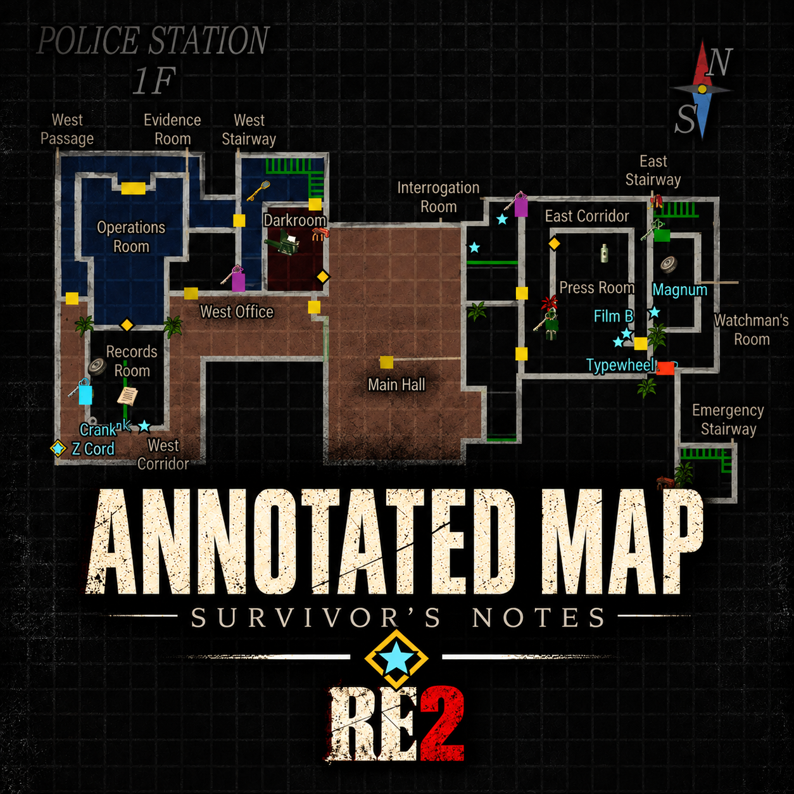
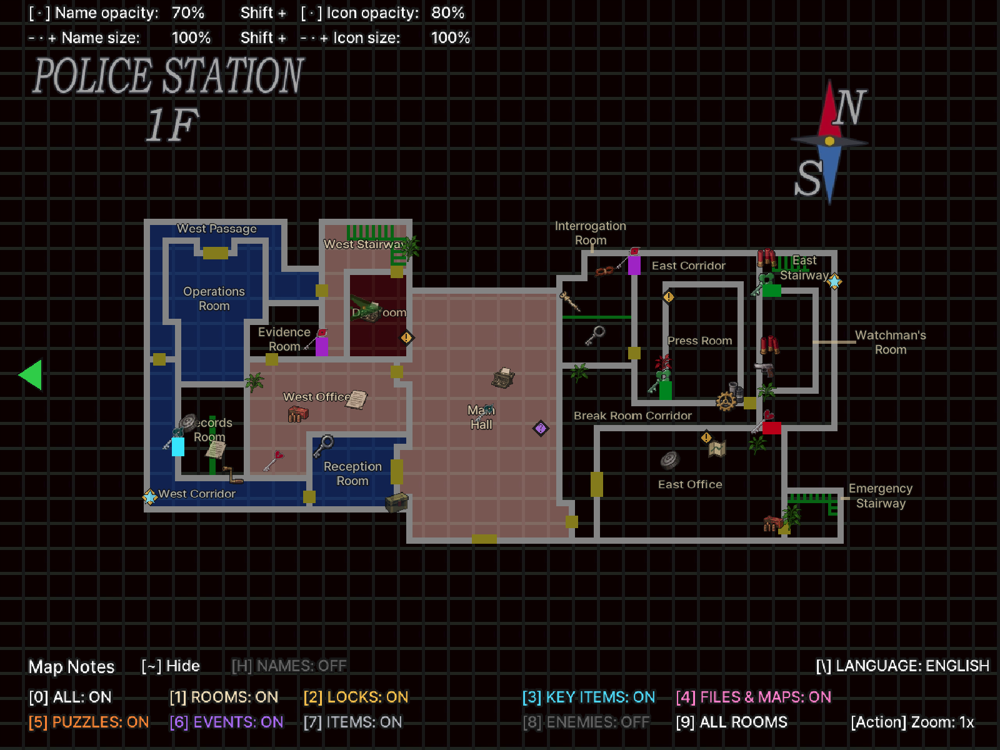
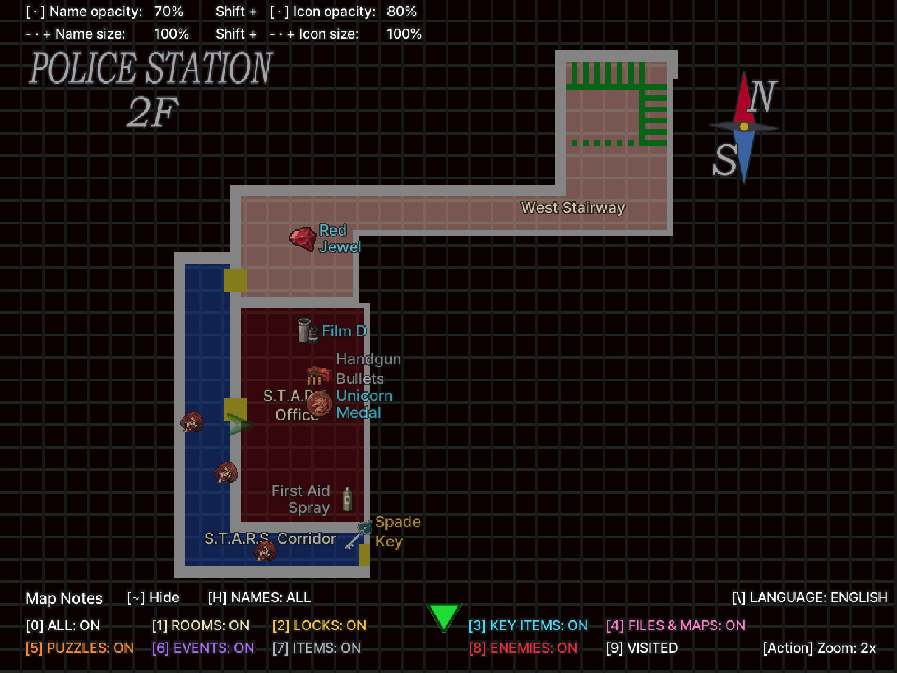
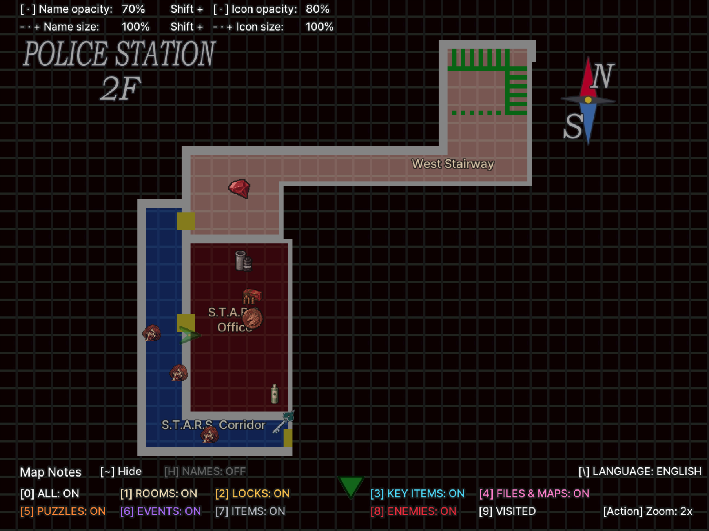
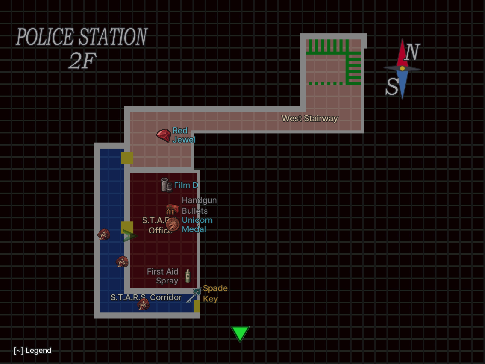
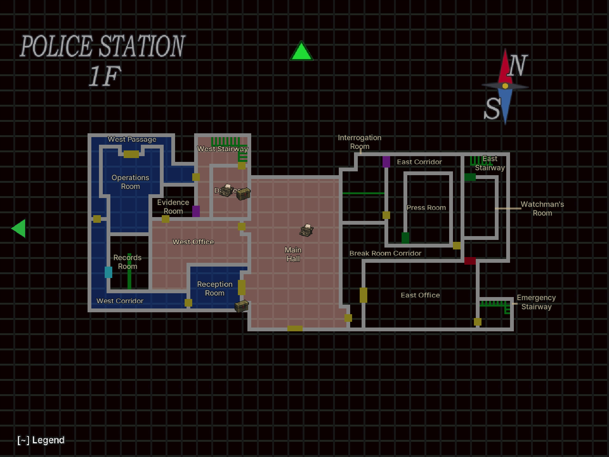

# RE2 Annotated Map - Survivor's Notes — Resident Evil 2 (1998)

[English](README.md) | 한국어

<p align="center"></p>

**상세 지도: 생존자의 메모** — 원작 Resident Evil 2 PC판(GOG판 `Resident Evil 2.exe` + [Classic REbirth](https://classicrebirth.com/))의 지도에 방 이름, 잠긴 문과 필요한 열쇠, 핵심 아이템, 문서·지도, 퍼즐, 일반 아이템, 타자기·아이템 상자, 몬스터를 표시하는 ASI 모드입니다. 한국어/영어를 지원합니다. RE2 리메이크(2019)용이 아닙니다.

- 게임 자체의 지도 화면에 표시합니다. 주운 아이템, 연 문, 푼 퍼즐, 쓰러뜨린 몬스터는 지도에서 사라집니다. 아이템이 남은 방은 주황색으로 칠합니다.
- 레온/클레어, A/B 시나리오에 따른 아이템·잠긴 문 차이를 반영합니다. 재핑 아이템도 표시합니다.
- 상태 화면 지도에서 좌/우로 장소, 위/아래로 층을 고를 수 있습니다. 이미 방문한 층만 보입니다.
- 결정 버튼으로 지도를 2배로 확대하고, 방향 입력으로 옮길 수 있습니다.
- 원작 결과 화면 공식으로 계산한 랭크 예상치를 켤 수 있습니다(기본 끔).

## 스크린샷


*경찰서 1층: 범례와 모든 분류(퍼즐·이벤트 포함)를 켠 화면.*


*2층 확대, 방문한 방, 표식 이름 켬.*


*같은 화면에서 표식 이름을 끈 모습(아이콘만).*


*2층 확대, 적을 이름과 함께 표시.*


*1층, 방과 잠금만 켠 화면.*

## 표시 범위와 기본값

새 설정은 **영어, 이름 크기 100%, 이름 불투명도 70%, 아이콘 크기 100%, 아이콘 불투명도 80%, 방문한 방만 표시, 방 이름만 켬, 표식 이름 끔**으로 시작합니다. `H`로 표식 이름을 켭니다. `\`(₩)로 한국어, `2`–`7`로 다른 항목을 켭니다. 랭크 예상치는 꺼져 있습니다. `9`로 범위를 바꿉니다. **모든 방**은 미방문 구역과 아이템을 미리 보여줍니다. 방문한 층만 장소·층 선택에 나타납니다.

## HD와 SD

모드는 처음 지도를 열 때 표시 방식을 한 번 정합니다.

- **HD**: Classic REbirth에 HD 텍스처(`bio2hd.asi` 로드)가 있고 `config.ini`의 `[DLL]`에서 `RetroMode`와 `LowResEnable`이 모두 꺼져 있을 때. 게임의 고해상도에 맞춘 선명한 이름과 아이콘.
- **SD**: 그 밖의 모든 경우(Classic REbirth가 없는 게임 포함). 1배 픽셀 마커와 픽셀 글꼴(Galmuri9). 방 이름은 한 가지 색으로 짧은 선을 달고 방 옆에 붙으며 1배·2배 확대에서 모두 보입니다. SD에서는 이름·아이콘 크기, 불투명도, 아이템 이름, 랭크 예상치를 쓸 수 없고 핵심 아이템은 하늘색 원 하나로 표시됩니다.

INI의 `DisplayMode=SD` 또는 `HD`로 방식을 고정할 수 있습니다(설정 참고).

## 설치

1. Resident Evil 2용 **Classic REbirth**를 먼저 설치합니다(1.0.9에서 확인). [공식 다운로드](https://classicrebirth.com/index.php/downloads/resident-evil-2-classic-rebirth/)
2. 게임을 종료합니다. [Releases](https://github.com/eggu/resident-evil-2-annotated-map/releases/latest)에서 `RE2-Annotated-Map-<버전>.zip`을 받아 압축을 풉니다. `Source code`는 설치 파일이 아닙니다.
3. ZIP의 내용(`dsound.dll`, `scripts/`)을 `Resident Evil 2.exe`가 있는 게임 폴더에 폴더 구조 그대로 복사합니다. ASI 로더인 [Ultimate ASI Loader](https://github.com/ThirteenAG/Ultimate-ASI-Loader) v9.7.4(MIT)가 `dsound.dll`로 포함되어 있습니다.
   - 한글 패치 등으로 Ultimate ASI Loader가 이미 `dsound.dll`로 설치되어 있으면 `dsound.dll`은 건너뛰어도 됩니다.
   - ASI 로더가 아닌 다른 `dsound.dll`(예: DSOAL)이 있으면 덮어쓰지 말고, 포함된 `dsound.dll`을 `winmm.dll` 이름으로 복사하세요.

업그레이드할 때는 `scripts/RE2.AnnotatedMap.ini`를 건너뛰거나 백업 후 복원하세요.

제거: `scripts/RE2.AnnotatedMap.asi`, `.ini`, `.log`를 지웁니다. 다른 ASI 모드가 없으면 `dsound.dll`도 지웁니다. EXE와 세이브는 수정하지 않습니다. 지원 대상이 아닌 실행 파일에서는 코드 서명을 확인한 뒤 아무것도 패치하지 않고 로그만 남깁니다.

## 단축키

지도 화면에서만 작동하며, 현재 상태는 왼쪽 아래 범례에, 크기·불투명도 값은 왼쪽 위에 표시됩니다. 이름과 아이콘은 2배 확대에서 1.43배로 커집니다. 범례나 값 표시에 닿는 표식은 그리지 않습니다. 같은 키를 0.35초 안에 다시 누르면 무시합니다.

| 키 | 동작 |
|---|---|
| 0 | 전체 표시 켜기/끄기 |
| 1 | 방 이름·타자기·아이템 상자 |
| 2 | 잠긴 문·열쇠 |
| 3 | 핵심 아이템 (+ 재핑 아이템) |
| 4 | 문서·지도 |
| 5 | 퍼즐 |
| 6 | 이벤트(스포일러: 컷신 장면 위치, 보라색 `?` 마름모. 이름은 표시하지 않으며 `H`의 영향도 받지 않음. 장면이 지나가면 사라짐) |
| 7 | 일반 아이템(탄약·회복·잉크 리본) |
| 8 | 적 (방문한 방) |
| 9 | 표시 범위: 방문한 방 → 공개된 방(층 지도 획득) → 모든 방 |
| `\`(₩) | 한국어 / English (범례 제목 줄 `[H]` 옆) |
| H | 표식 이름 3단계(누를 때마다): 모두 표시 → 일반 아이템 제외 → 모두 숨김 (기본 숨김). 대상: 핵심 아이템·잠긴 문 열쇠·지도·문서 이름·일부 퍼즐·일반 아이템. 문서와 일반 아이템 이름은 빈 자리에만. 범례 제목 줄에 현재 상태가 표시됩니다 |
| ~ (숫자 1 왼쪽) | 범례와 값 표시 켜기/끄기 |
| - · = (+), 숫자패드 - · + | 이름 크기 10%씩 (50–200%) |
| [ · ] | 이름 불투명도 10%씩 (10–100%) |
| Shift + - · = (+) | 아이콘 크기 10%씩 (50–200%) |
| Shift + [ · ] | 아이콘 불투명도 10%씩 (10–100%) |
| 좌 · 우, 위 · 아래 (상태 화면 지도) | 장소·층 선택 (방문한 층만) |
| 결정 버튼 (지도) | 지도 2배 확대 켜기/끄기 (지도를 다시 열면 1배) |
| 방향 입력 (2배 확대 중) | 지도 이동 |

`Shift`는 INI의 `Modifier=Ctrl`로 `Ctrl`로 바꿀 수 있습니다. 게임이 `Ctrl`을 쓰므로 기본은 `Shift`입니다.

`[Z]`는 재핑 표식입니다. A/B 시나리오 사이의 선택이나 행동에 영향을 주고받는 항목이며, 아이템 이름의 일부가 아닙니다.

## 설정 (`scripts/RE2.AnnotatedMap.ini`)

배포 ZIP에 설명 주석이 담긴 기본 설정 파일을 포함합니다. 편집 전 게임을 종료하고, 저장 후 게임을 다시 실행하세요. 게임 안에서 바꾼 설정은 자동으로 저장됩니다. 업그레이드할 때 기존 INI를 보존해야 사용자 설정을 유지할 수 있습니다.

| 항목 | 기본값 | 설명 |
|---|---|---|
| `All` | `1` | 전체 표시 스위치 |
| `Rooms` | `1` | 방 이름·타자기·아이템 상자 |
| `Locks` | `0` | 잠긴 문·열쇠 |
| `Items` | `0` | 핵심 아이템 |
| `Documents` | `0` | 문서·지도 |
| `Puzzles` | `0` | 퍼즐·장치 |
| `CommonItems` | `0` | 탄약·회복·잉크 리본 등 일반 아이템 |
| `Enemies` | `0` | 적 |
| `Events` | `0` | 이벤트(스포일러 장면) |
| `English` | `1` | `1` 영어, `0` 한국어 |
| `Scope` | `1` | `1` 방문한 방, `2` 층 지도로 공개된 방, `3` 모든 방(스포일러) |
| `NameSize` | `100` | 이름 크기(50–200). 100은 이전 버전의 80%입니다. 이전 설정의 값은 처음 한 번 자동으로 바꿔 크기가 그대로 유지됩니다 |
| `NameOpacity` | `70` | 이름 불투명도(10–100) |
| `ItemNames` | `0` | 표식 이름 (`H`): `1` 모두, `2` 일반 아이템 제외, `0` 숨김. 예전 `1`(켜짐)은 모두, `0`(꺼짐)은 숨김으로 그대로 읽습니다 |
| `IconSize` | `100` | 아이콘 크기(50–200) |
| `IconOpacity` | `80` | 아이콘 불투명도(10–100) |
| `Modifier` | `Shift` | 아이콘 크기·불투명도 보조 키: `Shift` 또는 `Ctrl` |
| `LockSide` | `1` | `1` 잠금 표식을 문 바로 옆, 열려 있는 쪽 방(문 뒤 잠긴 방이 아니라 들어갈 수 있는 방)에(RE1 HD 방식), `0` 문 위에. 1.4 이전 설정 파일은 한 번 `1`로 바뀝니다 |
| `DisplayMode` | `Auto` | `Auto`는 위의 HD·SD 규칙을 따르고 `HD`·`SD`는 고정. 변경 후 재실행 |
| `Version` | `5` | 설정 형식. 자동으로 기록되며 편집하지 않습니다 |
| `Rank` | `0` | `1`이면 랭크 예상치 표시. 변경 후 재실행 |

모든 항목은 `[MapOverlay]` 섹션에 있습니다.

## 알려진 한계

- GOG판 `Resident Evil 2.exe`만 지원합니다(HD는 Classic REbirth가 필요하고, 없으면 SD로 표시). 다른 실행 파일에서는 아무것도 적용하지 않고 로그만 남깁니다.
- 확대한 이름은 기존 위치를 유지하므로 좁은 지도에서 겹칠 수 있습니다.
- `LockSide=1`(기본)의 문 반대편 위치는 게임이 정한 문 앞 지점이라 문에서 몇 픽셀만 떨어져 있습니다. 다른 층으로 이어지는 문은 문 위에 그대로 둡니다.
- 적 표시는 출현 지점이며 실시간 위치가 아닙니다.

## 문제 신고

[Issues](https://github.com/eggu/resident-evil-2-annotated-map/issues)에 게임 판본, Classic REbirth 버전, 캐릭터·시나리오, 방·층, 언어·표시 범위와 스크린샷을 함께 남겨 주세요. 로딩 문제는 `scripts/RE2.AnnotatedMap.log`도 첨부하면 도움이 됩니다. 로그의 개인 경로는 지워 주세요.

## 위키

방 목록, 잠긴 문과 열쇠, 아이템·퍼즐·문서·세이브 지점, 몬스터, 랭크 계산은 [한국어 위키](docs/wiki/README.md)와 [English wiki](docs/wiki/README.en.md)를 참고하세요. 목록에는 스포일러가 포함됩니다.

## 빌드

```sh
python3 -m venv .venv && .venv/bin/pip install -r requirements.txt
.venv/bin/python build.py                                              # dist/ ZIP
.venv/bin/python build.py --game-exe '/path/to/Resident Evil 2.exe'    # + 원본 EXE 네이티브 테스트
```

`src/re2_keymap.c`가 런타임 소스이고, 나머지 헤더는 고정된 지도·이름·아이콘 데이터입니다. 자세한 내용은 [개발 문서](docs/DEVELOPMENT.md)를 참고하세요.

## 다른 지도 모드

- [RE1 Annotated Map - Survivor's Notes](https://github.com/eggu/resident-evil-annotated-map) — 바이오하자드 1 (1996)
- [RE3 Annotated Map - Survivor's Notes](https://github.com/eggu/resident-evil-3-annotated-map) — 바이오하자드 3 (1999)

## 크레딧과 라이선스

제작: **커트씨**. 소스는 [MIT License](LICENSE)입니다. 비공식 팬 모드이며 Capcom 및 Classic REbirth와 관련이 없습니다. 참고 자료, 이미지·글꼴 출처는 [NOTICE](NOTICE.md)에 있습니다.
