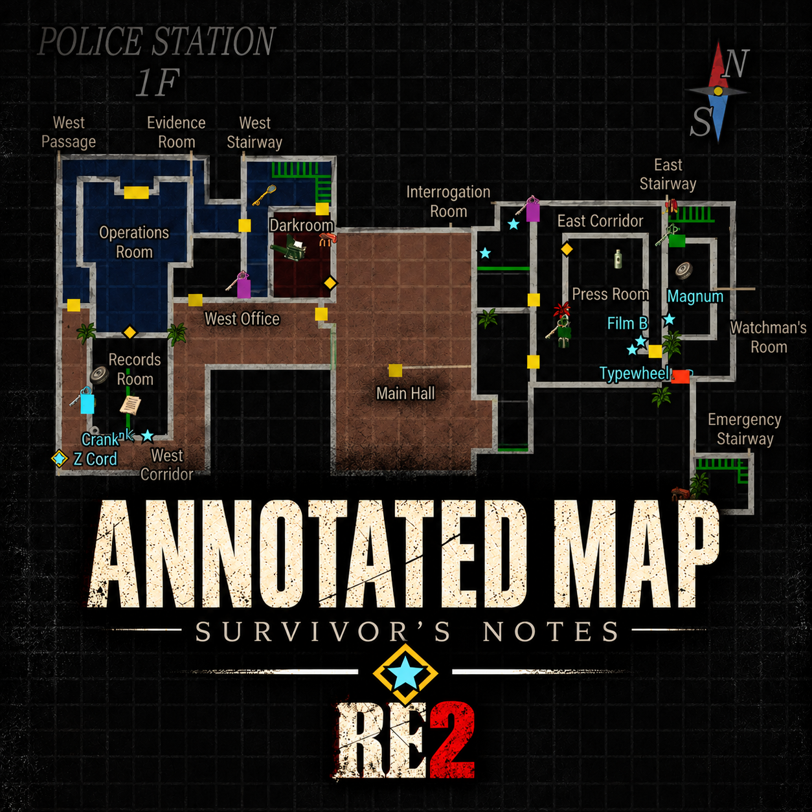
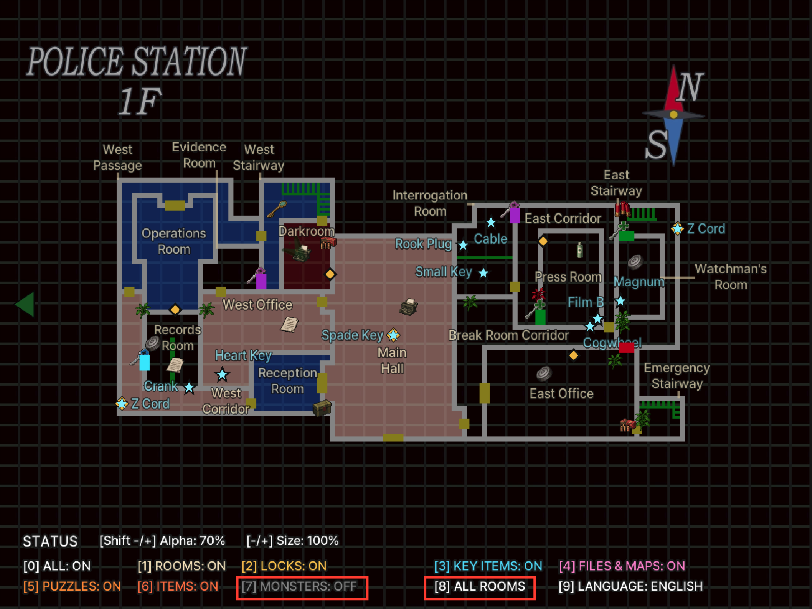
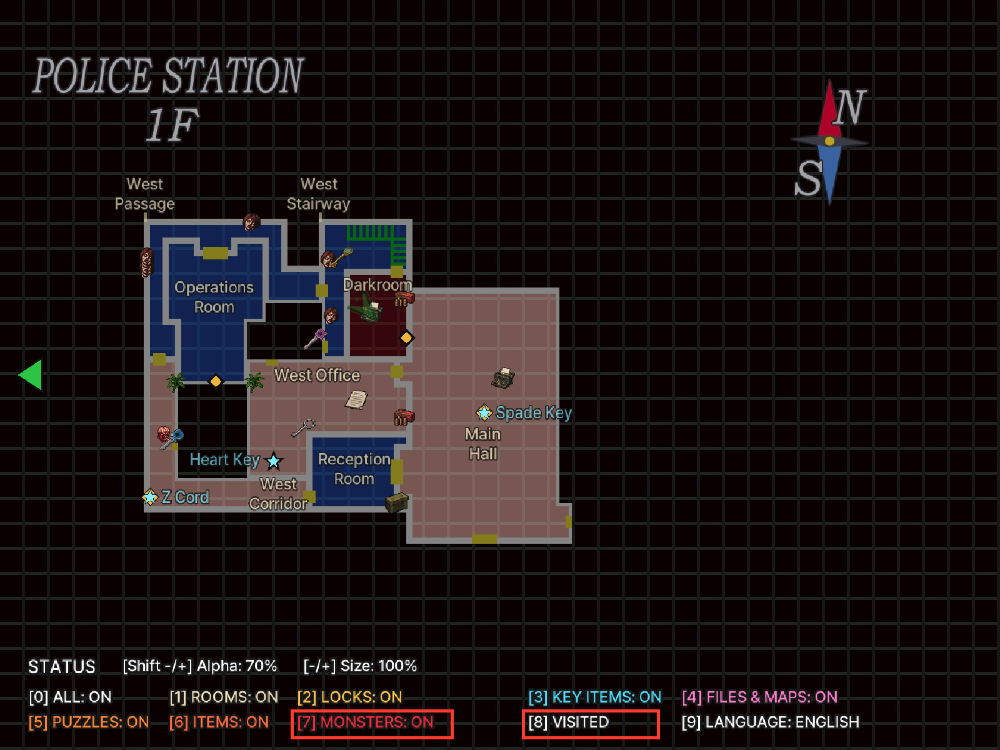
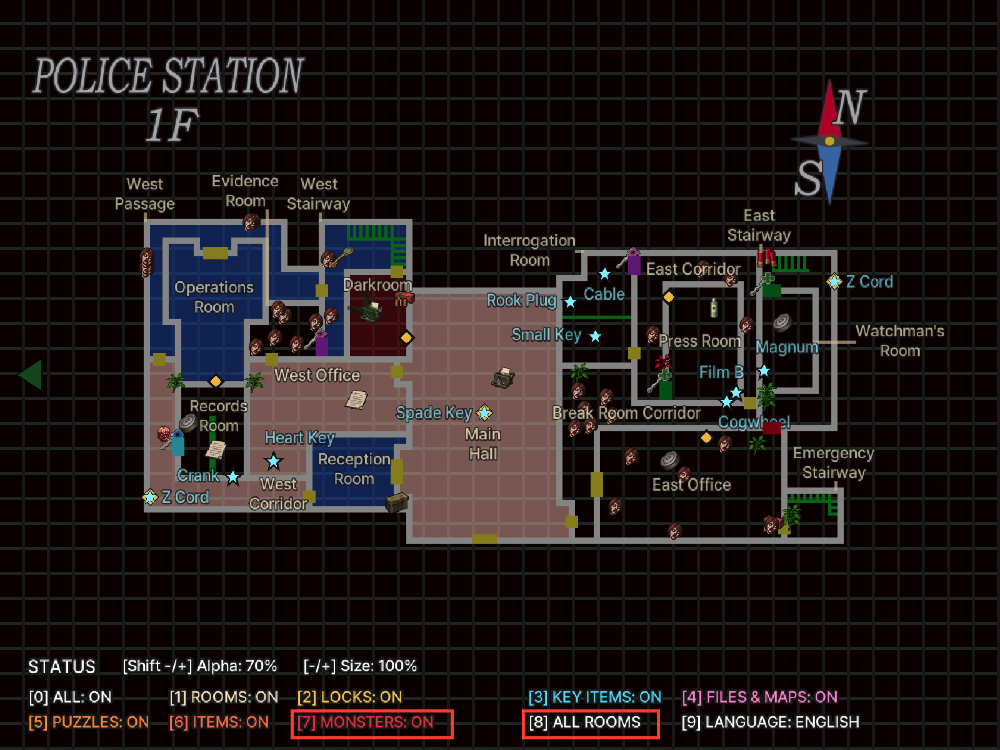

# RE2 Annotated Map - Survivor's Notes — Resident Evil 2 (1998)

English | [한국어](README.ko.md)

<p align="center"></p>

An ASI mod for the original Resident Evil 2 PC release (GOG `Resident Evil 2.exe` + [Classic REbirth](https://classicrebirth.com/)) that adds room names, locked doors and their keys, key items, documents and maps, puzzles, common items, typewriters and item boxes, and monsters to the map. Korean and English are supported. This is not for the 2019 remake.

- Annotations are drawn on the game's own map screen. Picked-up items, opened doors, solved puzzles and killed monsters disappear from the map. Rooms with items left are tinted orange.
- Item and lock differences between Leon/Claire and scenarios A/B are reflected. Zapping items are shown too.
- On the status-screen map, left/right selects an area and up/down selects a floor. Only visited floors are shown.
- The Action button zooms the map to 2x, and directions move it while zoomed.
- An optional live rank estimate uses the original results-screen formula (off by default).

## Screenshots

Red outlines highlight the monster toggle and room visibility scope being compared.

| | Visited rooms | All rooms |
|---|---|---|
| Monsters off |  |  |
| Monsters on |  |  |

## Visibility and defaults

A new configuration starts in **English, name size 100%, name opacity 70%, icon size 100%, icon opacity 80%, visited rooms only, with only Rooms on and marker names off**. Press `H` to show marker names. Press `\` for Korean and `2`–`7` to turn on other categories. The rank estimate is off. Press `9` to change scope. **All rooms** reveals unexplored rooms and items. Area/floor selection still lists visited floors only.

## Installation

1. Install **Classic REbirth** for Resident Evil 2 first (tested with 1.0.9). [Official download](https://classicrebirth.com/index.php/downloads/resident-evil-2-classic-rebirth/)
2. Close the game. Download `RE2-Annotated-Map-<version>.zip` from [Releases](https://github.com/eggu/resident-evil-2-annotated-map/releases/latest) and extract it. `Source code` is not the install package.
3. Copy the ZIP contents (`dsound.dll`, `scripts/`) into the folder containing `Resident Evil 2.exe`, preserving the directory structure. [Ultimate ASI Loader](https://github.com/ThirteenAG/Ultimate-ASI-Loader) v9.7.4 (MIT) is included as `dsound.dll`.
   - If Ultimate ASI Loader is already installed as `dsound.dll` (e.g. by a translation patch), you can skip `dsound.dll`.
   - If you have a different `dsound.dll` (e.g. DSOAL), do not overwrite it: copy the included one as `winmm.dll`.

When upgrading, skip `scripts/RE2.AnnotatedMap.ini` or back it up and restore it.

Uninstall: delete `scripts/RE2.AnnotatedMap.asi`, `.ini` and `.log`. Also delete `dsound.dll` if no other ASI mod uses it. The EXE and save files are not modified. On an unsupported executable the mod checks the code signatures, patches nothing and only writes a log.

## Controls

Keys work on the map screen only. The current state is shown in the legend at the lower left, sizes and opacities at the upper left. Names and icons grow 1.43x at 2x zoom. Markers touching the legend or the values are not drawn. A second press of the same key within 0.35 s is ignored.

| Key | Action |
|---|---|
| 0 | All annotations on/off |
| 1 | Room names, typewriters, item boxes |
| 2 | Locked doors and keys |
| 3 | Key items (+ zapping items) |
| 4 | Documents and maps |
| 5 | Puzzles |
| 6 | Events (spoilers: where story scenes start, a purple `?` diamond with no name and unaffected by `H`; hidden once the scene has played) |
| 7 | Common items (ammo, recovery, Ink Ribbons) |
| 8 | Enemies (visited rooms) |
| 9 | Visibility: visited rooms → revealed rooms (floor map picked up) → all rooms |
| `\` (₩ on Korean keyboards) | Korean / English (shown next to `[H]` in the legend's title line) |
| H | Marker names, three states on each press: all names -> all except common items -> all hidden (default hidden). Covers key items, lock keys, maps, document names, some puzzles and common items; document and common-item names only where there is room. The legend's title line shows the state |
| ~ (left of 1) | Show or hide the legend and values |
| - · = (+), numpad - · + | Name size in 10% steps (50–200%) |
| [ · ] | Name opacity in 10% steps (10–100%) |
| Shift + - · = (+) | Icon size in 10% steps (50–200%) |
| Shift + [ · ] | Icon opacity in 10% steps (10–100%) |
| Left · right, up · down (status-screen map) | Select area and floor (visited floors only) |
| Action button (map) | Toggle 2x map zoom (reopening the map returns to 1x) |
| Directions (while zoomed) | Move the map |

`Modifier=Ctrl` in the INI makes `Ctrl` the modifier instead of `Shift`. The default is `Shift` because the game uses `Ctrl`.

`[Z]` (`Z` in the screenshots) identifies a zapping-related item or interaction whose state is affected by choices or actions across scenarios A/B. It is not part of the item name.

## Settings (`scripts/RE2.AnnotatedMap.ini`)

The release ZIP includes a default INI with comments. Close the game before editing, save, then restart. Settings changed in game are saved automatically. Keep your existing INI when upgrading to preserve your settings.

| Setting | Default | Description |
|---|---|---|
| `All` | `1` | Master switch |
| `Rooms` | `1` | Room names, typewriters, item boxes |
| `Locks` | `0` | Locked doors and keys |
| `Items` | `0` | Key items |
| `Documents` | `0` | Documents and maps |
| `Puzzles` | `0` | Puzzles and devices |
| `CommonItems` | `0` | Ammo, recovery items, Ink Ribbons and other common pickups |
| `Enemies` | `0` | Enemies |
| `Events` | `0` | Events (story-scene spoilers) |
| `English` | `1` | `1` English, `0` Korean |
| `Scope` | `1` | `1` visited rooms, `2` rooms revealed by a floor map, `3` all rooms (spoilers) |
| `NameSize` | `100` | Name size (50–200). 100 is the former 80%; an older file's value is converted once so the size stays |
| `NameOpacity` | `70` | Name opacity (10–100) |
| `ItemNames` | `0` | Marker names (`H`): `1` all, `2` all except common items, `0` hidden. The old `1` (on) reads as all and `0` (off) as hidden |
| `IconSize` | `100` | Icon size (50–200) |
| `IconOpacity` | `80` | Icon opacity (10–100) |
| `Modifier` | `Shift` | Modifier for icon size/opacity: `Shift` or `Ctrl` |
| `LockSide` | `0` | `0` lock markers on the door, `1` in the room not entered yet (RE1 HD style) |
| `Version` | `4` | Settings format, written automatically; do not edit |
| `Rank` | `0` | `1` shows the rank estimate. Restart after changing |

All settings are in the `[MapOverlay]` section.

## Known limitations

- Only the GOG `Resident Evil 2.exe` with Classic REbirth is supported. Other executables load nothing and only write a log.
- Enlarged names keep their positions, so they can overlap on crowded maps.
- With `LockSide=1` the other side is the game's own spot just past the door, only a few pixels away. Doors leading to another floor keep the marker on the door.
- Enemy markers show spawn points, not live enemy positions.

## Support

Report issues in [Issues](https://github.com/eggu/resident-evil-2-annotated-map/issues) with the game edition, Classic REbirth version, character/scenario, room/floor, language/scope and a screenshot. For loading problems, include `scripts/RE2.AnnotatedMap.log`, removing personal paths before sharing.

## Wiki

See the [English wiki](docs/wiki/README.en.md) or [한국어 위키](docs/wiki/README.md) for rooms, locked doors and keys, items, puzzles, documents, save points, monsters and rank scoring. The reference tables contain spoilers.

## Build

```sh
python3 -m venv .venv && .venv/bin/pip install -r requirements.txt
.venv/bin/python build.py                                              # dist/ ZIP
.venv/bin/python build.py --game-exe '/path/to/Resident Evil 2.exe'    # + native tests against the original EXE
```

`src/re2_keymap.c` is the runtime source; the other headers are pinned map, label and icon data. See the [development notes](docs/DEVELOPMENT.md).

## Other map mods

- [RE1 Annotated Map - Survivor's Notes](https://github.com/eggu/resident-evil-annotated-map) — Resident Evil (1996)
- [RE3 Annotated Map - Survivor's Notes](https://github.com/eggu/resident-evil-3-annotated-map) — Resident Evil 3: Nemesis (1999)

## Credits and license

Created by **커트씨**. The source code is under the [MIT License](LICENSE). This is an unofficial fan mod, unaffiliated with Capcom or Classic REbirth. References and image/font provenance are listed in [NOTICE](NOTICE.md).
